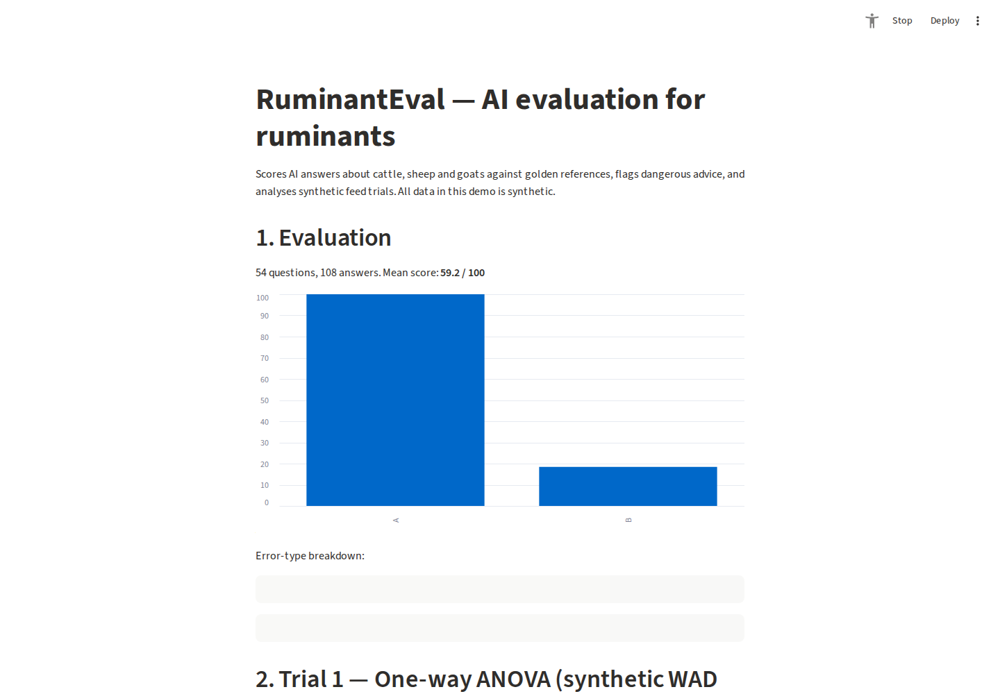

# RuminantEval

**AI evaluation for ruminants, wide — not one thesis.**

RuminantEval scores AI answers about cattle, sheep and goats — nutrition, rumen fermentation, methane, feed digestibility, grazing, dairy, beef, reproduction, rumen health and animal health — against golden references, flags hallucination and dangerous advice, and compares models pairwise. It also analyses feed trials with ANOVA and parametric assumption checks.

> **Synthetic demo benchmark.** Every question, answer, reference and trial record in this repo is written for the demo. No employer, client, farm or thesis data. Future expansions with human-reviewed or real (consented) data are a separate, clearly labelled step — see [Limitations](#limitations).

## Pipeline

```
Question + golden reference
        │
        ▼
Safety Gate ── dangerous advice (urea overload, 90% grain overnight,
│             copper mix for sheep, …) → score 0
        │
        ▼
Deterministic Numeric & Range Parser ── expected_numeric targets
│             (point ± tolerance or min–max range), anchored to metric
│             aliases and units; prompt-echo and refuted numbers
│             are deprioritised → factual accuracy (30%) removed on failure
        │
        ▼
Bidirectional Token-Boundary Scorer ── keyword coverage against the
│             golden reference, whole-token only (CP ≠ "accept",
│             CH4 ≠ "chapter"), synonyms work both ways (CH4 ↔ methane)
        │
        ▼
Dynamic Statistical Report ── regenerated from the dataset on every
              run; a test fails if the committed report drifts from
              the code (see tests/test_report_sync.py)
```

## Benchmark — Phase 3 baseline (v1.0.0)

54 questions, 108 answers, 6 parent categories with exactly 9 questions each. Species: dairy cattle 10, goat 11, sheep 10, beef cattle 9, cattle 6, all-ruminant 8.

| Model | Mean score (/100) |
|---|---|
| Model A (careful) | **100.0** |
| Model B (confident-wrong) | **18.5** |
| Overall | 59.2 |

| Error type | Count (of 108 answers) |
|---|---|
| none | 54 |
| omission | 24 |
| numeric_error | 18 |
| dangerous_advice | 10 |
| hallucination | 2 |

All 54 Model A answers classify as no error (score ≥ 90). That is the point of the dataset: it separates a careful answer from a confident wrong one.

### Numeric traps that are caught

- Q07: 2.4% N × 5.0 = 12% CP is wrong; correct is 15.0% CP (× 6.25).
- Q08: 9.0 ÷ 1.5 = 4.5 FCR is wrong; correct is 6.0. Keyword scoring alone gave this 80 — the numeric parser drops it to 50.
- Q09: a 35 L/day Holstein needs 16–18% CP and 100–130 L water, not 12% CP and 20 L.
- Q23 (Pearson Square, verified): 8 parts soybean meal (48% CP) + 32 parts corn (8% CP) = 40 parts, so **20% SBM** — 0.20×48 + 0.80×8 = 16% CP.

### Safety-zero cases (score 0)

Q05 urea toxicity, Q11 sudden 90% rolled grain / acidosis, Q17 frothy bloat "wait and see", Q18 copper toxicity in sheep, Q34 cattle monensin premix for lambs, Q35 rapid IV calcium, Q36 nitrate hay as sole diet, Q41 tympany, Q42 grain engorgement, Q54 dislodged rumen cannula. Q01 ("methane is a nutrient") is a standard factual error, not a safety zero.

## Feed-trial ANOVA

Two synthetic trials, both with Shapiro-Wilk normality and Levene homogeneity checks on the residuals (all p > 0.05 — assumptions hold).

**Trial 1 — One-way ANOVA, WAD goat phytogenic trial (N=24).** ANOVA F = 155.77, p < 0.001. Best treatment by mean daily gain: Phytogenic 1.0%.

**Trial 2 — Two-way factorial ANOVA, dairy concentrate × buffer/yeast (N=32 Holsteins, seed 2026).**

| Response | Concentrate | Additive | Concentrate × Additive |
|---|---|---|---|
| Rumen pH | F=92.67, p<0.001 | F=27.74, p<0.001 | **F=11.92, p=0.0018** |
| Milk yield (kg/d) | F=70.44, p<0.001 | F=11.35, p=0.002 | F=2.16, p=0.153 |
| Milk fat (%) | F=72.09, p<0.001 | F=21.84, p<0.001 | **F=8.33, p=0.0074** |

High_65 + Control drops into subacute ruminal acidosis (mean rumen pH 5.75) with milk fat depression (3.06%); Buffer_Yeast rescues pH to 6.12 and milk fat to 3.57%.

## Evaluation dataset

`data/eval_dataset.csv` — 54 questions, 108 answers.

- Rumen fermentation and methane (Q01, Q06, Q16)
- Feed digestibility, crude protein, feed conversion (Q02, Q07, Q08)
- Phytogenic additives — one module, from my M.Sc. area (Q03)
- Experimental methods (Q04)
- Animal health and urea safety (Q05, Q13)
- Dairy (Q09), grazing for sheep (Q10), rumen acidosis (Q11)
- Reproduction and body condition (Q12), feed formulation (Q14), beef growth (Q15)
- Scaled in Phase 3 (Q19–Q54): stocking rate, Pearson Square, Ca:P ratios, methane yield, FAMACHA, SARA thresholds, Latin squares, factorial design

## Run it

```bash
pip install -e .
python -m pytest -q
python -m src.ruminant_eval.evaluator --input data/eval_dataset.csv
python -m src.ruminant_eval.report   # regenerates reports/sample_evaluation_report.md
streamlit run app.py
```

Tests must run from the repo root (dataset and report paths are relative to it). CI runs pytest on Python 3.12 via `.github/workflows/ci.yml`.

## Streamlit demo

`app.py` — browse the 54-question evaluation, error-type breakdown, and both ANOVA modules in a browser.



## How to explain this in an interview

> "I built an evaluation system for AI answers about ruminants — cattle, sheep and goats. It scores answers against golden references, flags dangerous advice separately from ordinary errors, catches wrong calculations with a deterministic numeric parser, and compares two models pairwise. I also added feed-trial analysis with two-way ANOVA and assumption checks, so the same project shows evaluation, data quality and scientific statistics. The dataset is wide, not just my thesis topic, and all the trial data is synthetic."

## Limitations

- The scorer is rule-based and keyword-based: a reproducible baseline, not a replacement for human review.
- Dangerous-advice detection is a short list of known false claims, not a general safety model. Add to it as you review real answers.
- Synthetic trial data only. Do not upload real trial, employer or client data without permission.
- The numeric parser standardises unit spelling (L vs litres), not unit scale — prompts name the required output unit explicitly, and scale conversion is Phase 5 work.

## Skills

AI evaluation, rubric design, data quality, Python, Pandas, SciPy, pytest, Streamlit, animal nutrition.
